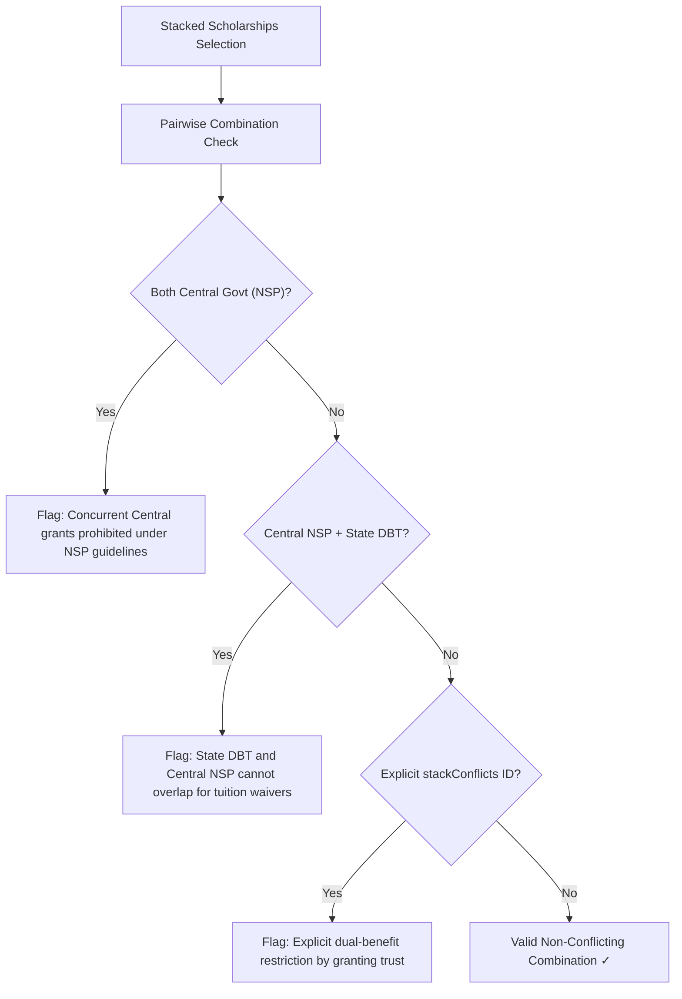

# GRANTLY Matching Engine & Eligibility Logic Specification

> **Module Scope:** Deterministic Scoring Engine, Near-Miss Gap Diagnosis, Concurrency Conflict Detector, and Vault Readiness Gauge  
> **Source Modules:** `src/utils/matchCalculator.ts`, `src/utils/stackConflictDetector.ts`, `src/context/ScholarshipContext.tsx`  
> **Guiding Principle:** Deterministic, mathematically reproducible matching with zero opaque black-box machine learning.

---

## 1. Deterministic Match Scoring Engine (`src/utils/matchCalculator.ts`)

The core scoring engine maps a student's active profile (`StudentProfile`) against every scholarship in the catalog (`Scholarship`) across 5 weighted dimensions yielding a score from 0 to 100 points:

$$\text{Overall Score} = W_{\text{academic}} + W_{\text{level}} + W_{\text{field}} + W_{\text{income}} + W_{\text{social}}$$

### Weight Distribution & Criteria Rubric

| Dimension | Max Points | Evaluation Algorithm |
| :--- | :--- | :--- |
| **Academic Merit (CGPA)** | **30 pts** | • `marksCgpa >= minCgpa`: Full **30 pts**. • Shortfall $\le 0.5$ CGPA: **15 pts** (tagged as repairable near-miss gap). • Shortfall $> 0.5$ CGPA: **0 pts**. |
| **Education Level** | **25 pts** | • Student `academicLevel` matches scholarship's `educationLevel` array: Full **25 pts**. • No match: **0 pts**. |
| **Branch / Field of Study** | **15 pts** | • Scholarship accepts `'All Streams'` or exact branch substring: Full **15 pts**. • STEM matching for Engineering/Computer Science: Full **15 pts**. • No match: **0 pts**. |
| **Family Annual Income** | **20 pts** | • No income cap (`familyIncomeCapMax === 0`): Full **20 pts**. • Full EWS (`< ₹2.5 Lakhs`): Full **20 pts** across all schemes. • Verified income clears scheme ceiling: Full **20 pts**. • Exceeds ceiling: **0 pts** (tagged as non-repairable income ceiling gap). |
| **Social / Affirmative Action** | **10 pts** | • Student reservation category matches target categories: Full **10 pts**. • Single Girl Child / First-Generation Learner tag matches scheme targets: Full **10 pts**. • Open merit scheme with no affirmative quotas: Full **10 pts**. • Quota not met: **0 pts**. |

---

## 2. Match Eligibility Tiers

Scholarships are dynamically segmented into three confidence tiers based on the calculated score:

- **High Match Tier ($\ge 75\%$)**: The student clears all primary gates (academic, income, level) and has maximum win probability. Highlighted with emerald badges in the UI.
- **Moderate Match Tier ($50\% - 74\%$)**: The student satisfies core criteria but may have a near-miss or partial reservation category overlap.
- **Low Match Tier ($< 50\%$)**: Disqualified on multiple non-negotiable criteria (e.g. wrong educational level or significantly above income cap).

---

## 3. "Almost Eligible" Gap Analysis & Remediation Engine

When a scholarship is not a 100% match, the engine checks for **repairable shortfalls** to rescue discarded grants:

1. **Academic CGPA Shortfall**:
   - Condition: `student.marksCgpa < scholarship.minCgpa` and `shortfall <= 0.5`.
   - Diagnosis: Plain-English notification (e.g., *"0.35 CGPA below the cutoff threshold"*).
   - Actionable Remedy: Calculates exact target Semester Grade Point Average (SGPA) required in upcoming exams to lift the cumulative CGPA past the barrier.
2. **Missing Paperwork / Certification**:
   - Condition: Required certificates (e.g. Domicile or Income certificate) not verified in Document Vault.
   - Actionable Remedy: Prompts 1-click navigation to Document Vault with renewal portal links.
3. **Alternative Grant Surfacing**:
   - Dynamically filters the verified catalog for schemes within the same discipline/category where the student already achieves a $\ge 80\%$ match score.

---

## 4. Multi-Scholarship Concurrency Conflict Detector (`src/utils/stackConflictDetector.ts`)

Prevents administrative disqualification and legal "double-dipping" penalties when students apply for multiple concurrent grants:

- **Dual Central Rule**: National Scholarship Portal (NSP) guidelines prohibit concurrently drawing multiple central government maintenance or tuition allowances.
- **Central vs State Tuition Conflict**: State welfare departments (MAHADBT, SSP Karnataka) disallow simultaneous state tuition fee reimbursements if central NSP tuition aid is accepted.
- **CSR Complementarity**: Private trusts (Tata Trusts, Reliance Foundation) can be legally combined with government living stipends if tuition fees are not double-claimed.

---

## 5. Application Readiness Gauge (`src/context/ScholarshipContext.tsx`)

Computes a weighted percentage of essential documentation verified in the Universal Document Vault:

$$\text{Readiness \%} = \frac{\sum \text{Verified Items}}{\text{Total Essential Paperwork}} \times 100$$

- **`uploaded` (Verified)**: 100% item weight.
- **`expiring` (Renewal Due)**: 50% item weight (triggers renewal alert banner).
- **`missing` (Action Required)**: 0% item weight.
- Threshold $\ge 75\%$ displays **High Readiness** status, unlocking confidence across all applications.
