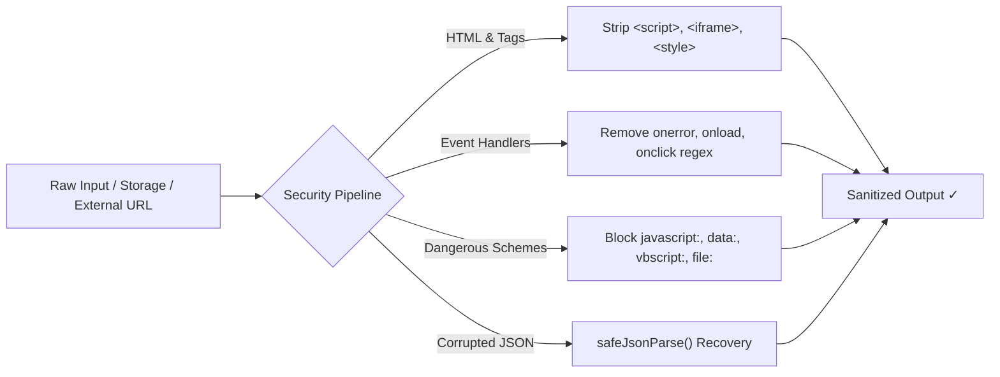

# GRANTLY Security & Data Sovereignty Architecture

> **Security Posture:** Enterprise-Grade Client Sovereignty & Input Defense  
> **Source Modules:** `src/utils/security.ts`, `src/hooks/useLocalStorage.ts`, `vercel.json`  
> **Core Guarantee:** Zero student personally identifiable information (PII) is ever transmitted to, logged by, or monetized on external cloud servers.

---

## 1. Client-Side Data Sovereignty

In conventional EdTech platforms, student financial records, family income brackets, caste validity certificates, and Aadhaar numbers are collected and stored on remote databases, creating attractive targets for data breaches.

**Grantly operates under a strict Zero-Cloud-Leakage architecture:**
- All personal student credentials (`StudentProfile`), tracked application notes (`TrackedApplication`), document vault records (`DocumentVaultItem`), and user sessions persist exclusively in the user's browser memory (`localStorage`).
- No backend database or third-party analytical telemetry is connected.
- Document Vault processes **metadata only** (e.g. document type, expiration dates, verified flags); no sensitive binary image or PDF files are parsed or persisted into unencrypted browser storage.
- A client-side JSON export tool gives students complete data portability and offline backup capability.

---

## 2. Input Sanitization & XSS Defense Pipeline (`src/utils/security.ts`)

Every string input entering Grantly via search bars, onboarding forms, profile settings, or workspace note-taking passes through a multi-stage sanitization pipeline:



### Sanitization Utilities

- **`sanitizeInput(input: unknown): string`**:
  - Trims leading/trailing whitespace.
  - Strips dangerous HTML tags (`<script>`, `<iframe>`, `<style>`, `<embed>`, `<object>`).
  - Strips inline DOM event attributes (`onerror=`, `onload=`, `onclick=`).
  - Neutralizes unescaped angle brackets into HTML entities (`&lt;` and `&gt;`).
  - Non-string inputs are safely coerced to clean strings.
- **`sanitizeUrl(url: unknown, fallback: string = '#'): string`**:
  - Blocks executable pseudo-protocols (`javascript:`, `data:`, `vbscript:`, `file:`).
  - Enforces secure `https://` protocol on all external links (automatically upgrading any legacy `http://` links).
  - All external hyperlinks declare `target="_blank" rel="noopener noreferrer"` to prevent reverse tab-jacking.
- **`sanitizeProfileStrings<T extends object>(record: T): T`**:
  - Deeply sanitizes all string fields within student profiles before state commitment and persistence.

---

## 3. Defensive Storage Deserialization (`safeJsonParse`)

Browser `localStorage` is vulnerable to corruption from manual developer edits, browser crashes, or quota exhaustion. Rather than calling naked `JSON.parse()`, Grantly wraps every deserialization inside `safeJsonParse`:

```typescript
export function safeJsonParse<T>(
  raw: string | null | undefined,
  fallback: T,
  validator?: (data: unknown) => boolean
): T
```

- Catches `SyntaxError` exceptions and falls back cleanly to verified default objects.
- Supports runtime schema validator predicates to prevent state pollution.
- Logs defensive warnings in developer console without interrupting application execution.

---

## 4. Production HTTP Security Headers (`vercel.json`)

Grantly is served over Vercel Edge with enterprise HTTP response headers configured to mitigate clickjacking, MIME-type sniffing, cross-site scripting (XSS), and unauthorized hardware access:

```json
{
  "headers": [
    {
      "source": "/assets/(.*)",
      "headers": [
        { "key": "Cache-Control", "value": "public, max-age=31536000, immutable" }
      ]
    },
    {
      "source": "/(.*)",
      "headers": [
        { "key": "X-Content-Type-Options", "value": "nosniff" },
        { "key": "X-Frame-Options", "value": "DENY" },
        { "key": "Referrer-Policy", "value": "strict-origin-when-cross-origin" },
        { "key": "Permissions-Policy", "value": "camera=(), microphone=(), geolocation=()" },
        { "key": "Strict-Transport-Security", "value": "max-age=63072000; includeSubDomains" },
        {
          "key": "Content-Security-Policy",
          "value": "default-src 'self'; script-src 'self'; style-src 'self' 'unsafe-inline' https://fonts.googleapis.com; img-src 'self' data:; font-src 'self' data: https://fonts.gstatic.com; connect-src 'self'; object-src 'none'; base-uri 'self'; frame-ancestors 'none'; form-action 'self';"
        }
      ]
    }
  ]
}
```

---

## 5. Dependency Audit & Secret Hygiene

- **Vulnerability Status**: Clean `npm audit` with **0 vulnerabilities**.
- **No Committed Secrets**: `.env` and `.env.*` are explicitly quarantined in `.gitignore`.
- **Zero Remote Tracking**: Zero third-party ad pixels, trackers, or foreign analytics scripts are loaded.
