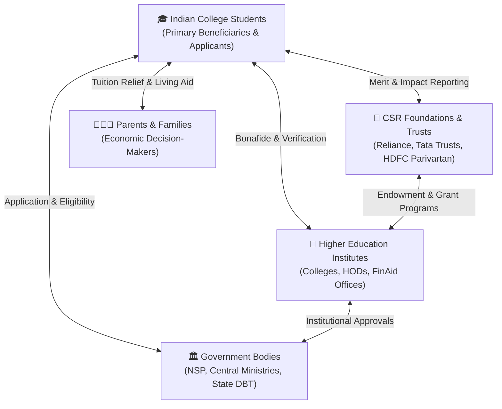
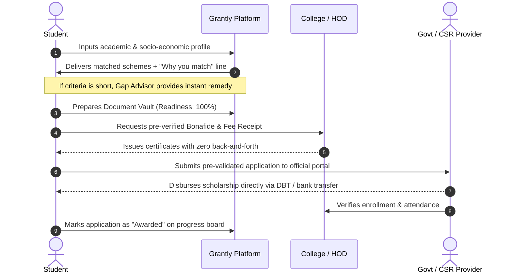

# GRANTLY Stakeholder Analysis & Ecosystem Architecture

> **Focus:** Indian Higher Education Financial Aid Ecosystem (Public, Private, and Non-Profit)  
> **Strategic Objective:** Aligning multi-sided incentives to accelerate scholarship adoption, eliminate paperwork dropouts, and support India's National Education Policy (NEP 2020) goals.

---

## 1. Executive Overview

The scholarship landscape in India is a complex, multi-sided ecosystem involving millions of students, thousands of colleges, central and state government ministries, and hundreds of Corporate Social Responsibility (CSR) foundations. 

A successful intervention cannot simply solve for the student in isolation; it must harmonize the workflows, verification constraints, and strategic incentives of all ecosystem participants.



---

## 2. Stakeholder Power-Interest Matrix (Mendelow's Grid)

The Power-Interest Matrix categorizes stakeholders by their ability to influence outcomes (Power) and their stake in the success of the platform (Interest):

```mermaid
quadrantChart
    title Stakeholder Power-Interest Matrix
    x-axis Low Power --> High Power
    y-axis Low Interest --> High Interest
    quadrant-1 Key Players (Manage Closely)
    quadrant-2 Keep Informed (Active Communication)
    quadrant-3 Monitor (Minimal Effort)
    quadrant-4 Keep Satisfied (Consult & Reassure)
    "College Students (All Tiers)": [0.85, 0.95]
    "Central NSP & State DBT Ministries": [0.90, 0.88]
    "CSR Foundations & Philanthropies": [0.75, 0.82]
    "College FinAid Officers & HODs": [0.80, 0.70]
    "Parents & Families": [0.35, 0.85]
    "Tehsildar & Domicile Issuers": [0.65, 0.35]
    "University Registrars & AICTE/UGC": [0.88, 0.45]
    "General Public & Cyber Café Operators": [0.20, 0.25]
```

---

## 3. Comprehensive Stakeholder Breakdown

### 3.1 Group 1: Indian Higher Education Students (Primary Beneficiaries)

| Attribute | Details |
| :--- | :--- |
| **Profile** | Undergraduate, Postgraduate, and PhD scholars across STEM, Arts, Medical, and Vocational programs. |
| **Key Segments** | 1. **EWS / Need-Based**: Family income < ₹2.5 LPA; dependent on tuition fee waivers.<br/>2. **First-Generation Learners**: First in family to attend college; zero home guidance.<br/>3. **STEM Diversity & Women**: Encouraged by targeted CSR programs (e.g. Reliance, Roll Royce).<br/>4. **SC / ST / OBC-NCL**: Government affirmative action schemes with complex caste validity rules. |
| **Core Pain Points** | • Missing deadlines due to fragmented portal announcements.<br/>• Confusing gazette eligibility criteria written in legal terms.<br/>• Expired income certificates causing sudden disqualification.<br/>• Time-consuming repetitive data entry across multiple websites. |
| **Grantly Value Proposition** | • Deterministic match score with clear 1-line **"Why you match"** explanations.<br/>• **"Almost Eligible" Gap Advisor** that turns near-misses into qualified submissions.<br/>• **Universal Document Vault** to track readiness and expiration dates.<br/>• Step-by-step **Application Tracker** with checklist progress. |
| **Success Metrics** | • Application completion rate (> 80%).<br/>• Average time to discover and verify eligibility (< 2 minutes).<br/>• Total scholarship funding secured per student. |

---

### 3.2 Group 2: Parents & Families (The Economic Anchor)

| Attribute | Details |
| :--- | :--- |
| **Profile** | Working-class, agrarian, and lower-middle-class parents funding college tuition. |
| **Core Pain Points** | • High anxiety over taking high-interest educational loans from non-banking lenders.<br/>• Lack of transparency on hidden college expenses (hostel, exam fees, book costs).<br/>• Inability to navigate digital English-only government websites. |
| **Grantly Value Proposition** | • **College Fee Coverage Calculator**: Visualizes total annual tuition vs scholarship awards.<br/>• Plain-English summaries with zero confusing jargon.<br/>• Clear timeline of when grant funds are disbursed into student bank accounts. |
| **Success Metrics** | • Reduction in out-of-pocket educational debt burden.<br/>• Improved parental peace of mind regarding ongoing semester affordability. |

---

### 3.3 Group 3: College & University Authorities (Institutional Verifiers)

| Attribute | Details |
| :--- | :--- |
| **Profile** | College Principals, Heads of Departments (HODs), Financial Aid Cells, and Registrars. |
| **Core Pain Points** | • Inundated by last-minute student requests for bonafide certificates and fee receipts.<br/>• Applications rejected at institutional verification level due to mismatched student data.<br/>• Poor institutional scholarship absorption negatively impacts NIRF and NAAC accreditation scores. |
| **Grantly Value Proposition** | • Pre-validated document checklist ensures students arrive with complete, valid paperwork.<br/>• Organized deadlines prevent end-of-month administrative bottlenecks.<br/>• Higher scholarship capture directly boosts college Gross Enrollment and retention rates. |
| **Success Metrics** | • 50%+ reduction in document re-submission cycles.<br/>• Increase in institution-wide scholarship funding capture. |

---

### 3.4 Group 4: Government Scholarship Bodies (NSP & State DBT)

| Attribute | Details |
| :--- | :--- |
| **Profile** | Ministry of Education, Ministry of Social Justice & Empowerment, Ministry of Tribal Affairs, State Social Welfare Departments (MAHADBT, SSP Karnataka, Medhabruti Odisha). |
| **Core Pain Points** | • Budget allocations lapse because eligible students fail to complete complex application pipelines.<br/>• Enormous administrative overhead auditing duplicate/conflicting applications ("double-dipping").<br/>• High bounce rate of applications due to minor paperwork defects. |
| **Grantly Value Proposition** | • Pre-screens students against precise eligibility rules (domicile, income ceiling, marks).<br/>• **Multi-Scholarship Planner** warns students against illegal concurrent double-dipping.<br/>• Increases quality and correctness of incoming submissions to official government portals. |
| **Success Metrics** | • Higher utilization of annual fiscal scholarship budgets.<br/>• Decreased rejection rates at state/central verification nodes. |

---

### 3.5 Group 5: Corporate CSR Foundations & Philanthropic Trusts

| Attribute | Details |
| :--- | :--- |
| **Profile** | Reliance Foundation, Tata Trusts, HDFC Bank Parivartan, Infosys Foundation, Aditya Birla Group. |
| **Core Pain Points** | • Mandatory corporate CSR mandates require deploying 2% net profits into verifiable social impact.<br/>• Difficulty reaching deserving rural, tier-2, and tier-3 students beyond metropolitan cities.<br/>• Low completion rates for intensive essay and interview-based selection rounds. |
| **Grantly Value Proposition** | • High-precision match engine surfaces corporate schemes directly to high-merit, needy students.<br/>• Built-in essay draft workspace and application roadmap increase completion rates.<br/>• Transparent data ensures CSR grants reach intended affirmative action demographics. |
| **Success Metrics** | • 100% CSR fund deployment to verified scholars.<br/>• Broad geographic and gender diversity across scholarship awardees. |

---

### 3.6 Group 6: National Policymakers & EdTech Ecosystem (Macro Alignment)

| Attribute | Details |
| :--- | :--- |
| **Strategic Goal** | Supporting the **National Education Policy (NEP 2020)** mandate to increase India's Higher Education **Gross Enrollment Ratio (GER)** from 27.1% to **50% by 2035**. |
| **Core Pain Points** | • Financial distress remains the #1 cause of college dropouts between 1st and 2nd year.<br/>• High disparity in financial aid access between urban and rural students. |
| **Grantly Value Proposition** | • Democratic, free, zero-login discovery layer accessible from any mobile browser.<br/>• Privacy-first design protects sensitive student caste, income, and identity information. |
| **Success Metrics** | • Measurable decrease in first-year college dropout rates attributable to fee shortages. |

---

## 4. Value Flow Diagram Across Stakeholders



---

## 5. Risk Assessment & Ethical Governance

| Potential Risk | Stakeholder Impact | Grantly Mitigation Strategy |
| :--- | :--- | :--- |
| **Data Privacy & Aadhaar Leakage** | High (Students, Regulators) | **Zero Cloud Storage**: All student records, marks, and certificates remain 100% inside the student's browser memory via `localStorage`. No remote server can leak their data. |
| **Outdated Portal Deadlines** | Medium (Students) | Live countdown indicators, clear "Target Date" timestamps, and direct external official portal links for final confirmation. |
| **Accidental Double-Dipping** | High (Govt, Colleges) | Multi-Scholarship Stacking engine automatically flags incompatible government assistance rules (e.g. NSP Central Sector cannot be stacked with State DBT). |
| **Accessibility & Digital Divide** | High (Rural Students) | Light mode default with high-contrast text, full mobile responsiveness, screen reader landmarks, and lightweight static footprint (sub-second bundle load). |

---

## 6. Strategic Takeaways

By satisfying the distinct priorities of all six stakeholder groups:
1. **Students** receive clarity, confidence, and financial security.
2. **Parents** gain transparent tuition visibility and freedom from debt.
3. **Colleges** streamline verification and elevate student retention.
4. **Government bodies** maximize budget absorption and eliminate fraud.
5. **CSR foundations** deploy impactful capital with high return on education.

Grantly transitions the scholarship process from an adversarial bureaucratic obstacle course into a collaborative, high-trust national financial co-pilot.
