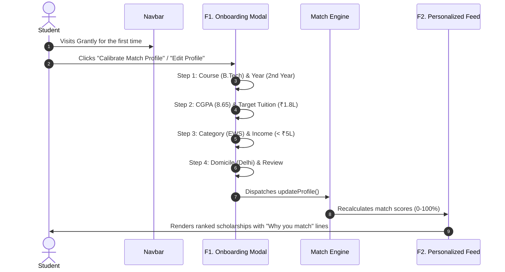

# GRANTLY Key User Flows & Persona Journeys

Mapped directly against Section 4 & Section 7 of the Hackathon Problem Statement.

---

## 1. Primary Student Personas

| Persona | Background & Context | Primary Pain Point | Grantly Solution Flow |
|---|---|---|---|
| **P1: First-Generation Student** | First in family to attend college; unfamiliar with Central/State quotas and document criteria. | Discovers required paperwork late; intimidated by bureaucratic jargon. | **Flow 1 & Flow 3**: Smart Onboarding pre-fills credentials; F5 Document Vault checklists identify missing certificates in advance. |
| **P2: Mobile-First Tier-2/3 Student** | Browses on a 4G mobile phone with intermittent connectivity and strict data limits. | Portals fail to render, PDF circulars don't load, navigation is confusing. | **Flow 2**: Zero heavy assets, lightweight dark UI, touch-friendly 44px targets, instant local filtering without server roundtrips. |
| **P3: Final-Year High-Merit Student** | Juggling rigorous exams, capstone projects, and multiple application deadlines. | Forgets critical portal closing dates; unaware of stacking restrictions. | **Flow 4 & Stretch**: F7 Deadlines Radar sorts by urgency; Stretch Stack Planner prevents illegal duplicate claims. |

---

## 2. Key User Journeys

### Flow 1: First Visit & Onboarding to Personalized Feed

---

### Flow 2: Discover, Compare, and Understand Options
1. **Search**: Student types *"Reliance"* or selects the `STEM` category pill in the filter bar.
2. **Review Feed**: Cards display verified source tags, effort estimates (`⚡ ~35 mins`), and match percentages.
3. **Compare**: Student taps "Compare" on Reliance and Tata Trusts to evaluate them side-by-side in `ComparisonModal`.
4. **Understand**: Student clicks "Understand" on Reliance to review:
   - Plain-English breakdown (no legal circulars).
   - 3-way checklist: 10/12 Marksheets (**Met ✓**), Income (< ₹15L **Met ✓**).
   - 3-step application roadmap.

---

### Flow 3: Fixing an "Almost Eligible" Gap
1. Student switches to **Almost Eligible (F4)** tab.
2. Views *L'Oréal India STEM Fellowship* flagged with a **Near Miss** score of 72%.
3. Grantly diagnoses exact gap: *"0.35 CGPA below marks cutoff"*.
4. Remedy suggestion: *"Target a +0.5 SGPA boost in upcoming semester exams"*.
5. In the meantime, Grantly surfaces 2 alternative schemes that the student *already* qualifies for (e.g. *Dr. Reddy's Sashakt*).
6. Student clicks "Fix in Document Vault" to verify outstanding certificates, raising their **Application Readiness** score.

---

### Flow 4: Apply, Track, and Manage Outcomes
1. Student saves Reliance Foundation grant to their **Pipeline (F6)**.
2. Card appears in **Saved** column on the 5-stage Kanban board.
3. Student clicks "Work" to open **Guided Application Workspace**:
   - Checks off uploaded documents.
   - Drafts personal statement on the continuous auto-saving scratchpad (with live word/character counters).
   - Records application portal reference ID.
4. Advances stage: `Saved` → `Preparing` → `Submitted` → `Under Review`.
5. Upon notification, advances to `Result` and clicks `Awarded`.
6. Won funding (₹2,00,000) automatically increments the confirmed won pool in `FinancialAidSummary`!
